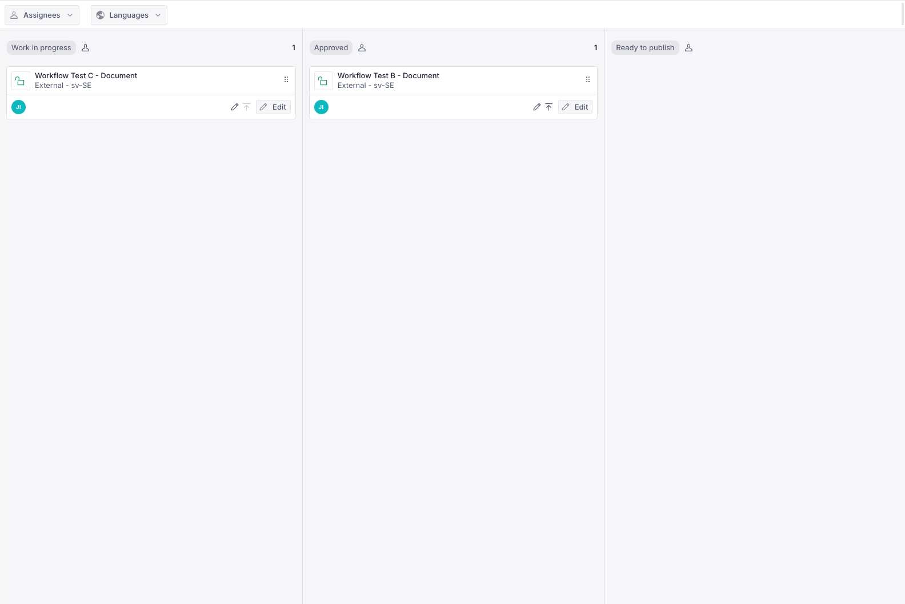
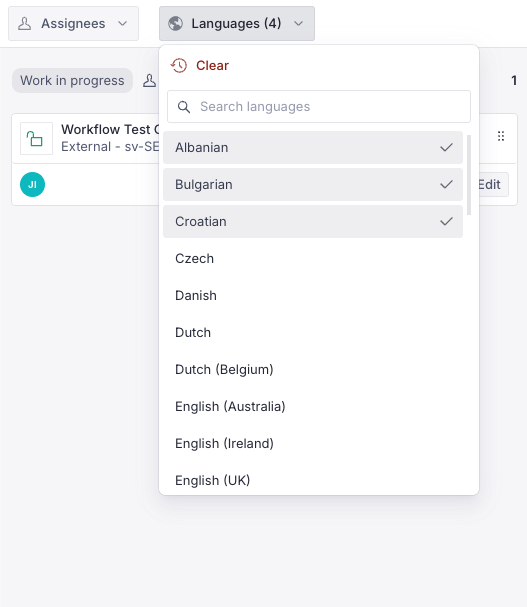
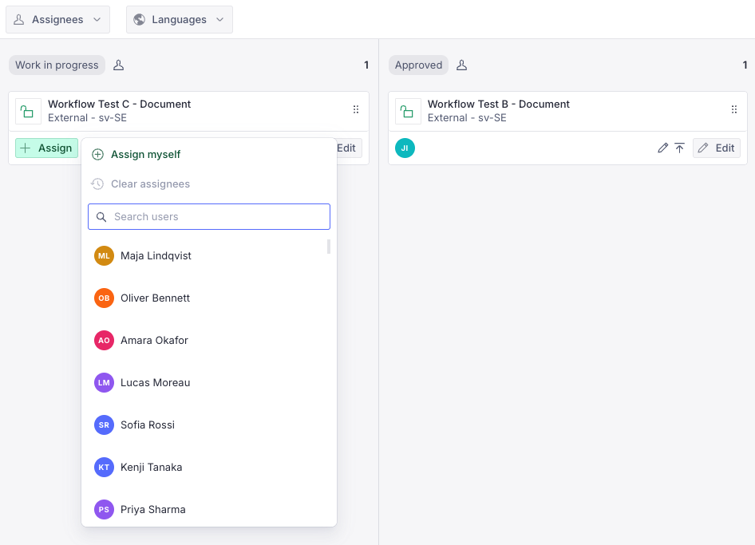
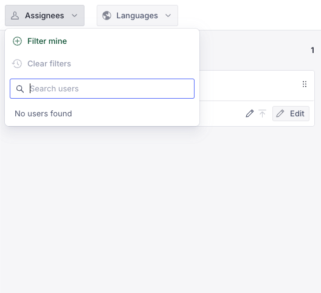
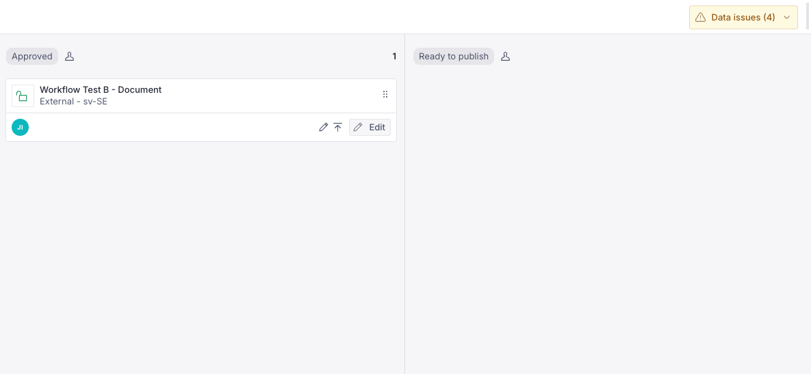
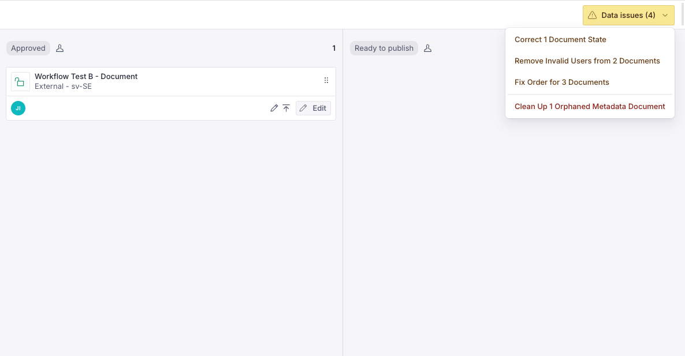

# Sanity Workflow Plugin - Electrolux Version (for Sanity Studio v6)

> This is a **Sanity Studio v6** plugin.
> This is a forked version of Sanitys own [Sanity Workflow Plugin (v1.0.3)](https://www.npmjs.com/package/sanity-plugin-workflow/v/1.0.3)

> [!WARNING]
> Breaking changes introduced in version 5.0.0 of this plugin. See [Breaking changes](#breaking-changes).



## Features

- A metadata document for each document in the Workflow, tracking its State, assignees, order and
  locale
- Document Actions to begin the Workflow, assign users, move a document between States and
  complete the Workflow
- Document Badges showing a document's State and assignees
- A "Workflow" Tool with a drag-and-drop board of documents by State
- Assignee and language filters on the board, so multi-market users can find what is relevant to
  them
- A "Data issues" menu that finds and repairs broken workflow metadata

## Install (Sanity Studio v6)

| Package / Runtime | Requirement |
| --- | --- |
| `sanity` | `^6.0.0` |
| `react` / `react-dom` | `^19.2.2` |
| `styled-components` | `^6.1.15` |
| Node.js | `>=22.12` |

Run

```zsh
npm install --save @electrolux-oss/sanity-plugin-workflow
```

or

```zsh
yarn add @electrolux-oss/sanity-plugin-workflow
```

## Usage

Add it as a plugin in `sanity.config.ts` (or .js) file:

```ts
import { defineConfig } from 'sanity'
import { workflow } from '@electrolux-oss/sanity-plugin-workflow'

export default defineConfig({
  // all other settings ...
  plugins: [
    workflow({
      // Required, list of document type names
      schemaTypes: ['article', 'product'],
      // Optional, see "Configuring States"
      // states: [],
      // Optional, see "Filtering by language"
      // filters: (user) => ({ locales: ['sv-SE', 'de-CH'] }),
      // languages: [{ id: 'de-CH', title: 'German (Switzerland)' }],
      // Optional, roles that see the "Data issues" menu; leave out to show it to everyone
      // dataIssueRoles: ['administrator'],
    })
  ]
})
```

## Filtering by language

Workflow documents store the `locale` of the document they track. To let users filter the board
by language, return the locales each user works in from `filters`. With no languages selected,
the board shows every locale the user works in.

`languages` sets the names shown in the language filter, in the same `{ id, title }` shape as
`supportedLanguages` in `@sanity/document-internationalization`, so the same list can be passed to
both. Locales without an entry fall back to their English name, such as "Swedish (Sweden)".



## Assigning users

Users are assigned to a document with the "Assign" document action or the Assign button on its
card on the board. The menu lists users holding a role from some State's `roles`. When `filters`
returns locales, it only lists users whose locales include the document's locale. Only users
holding a role for the State the document is in can change its assignees.



The board's Assignees filter lists everyone assigned to a document on the board, and "Filter mine"
shows the documents assigned to you.



## Data issues

The "Data issues" menu at the right of the board's filter bar finds broken workflow metadata and
shows how many documents it affects. It is disabled when there is nothing to fix. Set
`dataIssueRoles` to limit who sees it.



It offers a repair for each kind of issue:

- **Correct Document State** - moves documents whose State no longer exists in the config into the
  first State.
- **Remove Invalid Users** - removes assignees who are no longer in the project, or who only
  hold the Viewer role.
- **Fix Order** - gives every document in the affected States a new order rank, keeping their
  current order. It asks before running.
- **Clean Up Orphaned Metadata** - deletes workflow metadata whose document no longer exists. It
  asks before running, and cannot be undone.



See [Trying the data repairs](#trying-the-data-repairs) to try the menu without broken data.

## Configuring "States"

The plugin comes with a default set of "States". These are tracked by the plugin creating a separate "metadata" document for each document that has begun the Workflow.

Documents can be promoted and demoted in the Workflow with the provided Document Actions as well as a drag-and-drop custom Tool. The settings below are not enforced by the API, custom access control rules could be used to do so.

```ts
{
    // Required configuration
    id: 'inReview',
    title: 'In Review',
    // Optional settings:
    // Used for the color of the Document Badge
    color: 'success',
    // Only users with one of these Roles can move documents into or out of this State,
    // through document actions or drag-and-drop. Leave it out to allow everyone;
    // an empty array allows nobody
    roles: ['publisher', 'administrator'],
    // Requires the user to be "assigned" in order to move a document into this State
    requireAssignment: true,
    // Requires the document to be valid before being promoted out of this State
    // Warning: With many documents in the Kanban view this can negatively impact performance
    requireValidation: true,
    // Defines which States a document can be moved to from this one.
    // Leave it out to allow every State; an empty array allows none
    transitions: ['changesRequested', 'approved']
}
```

Wrap the list in `defineStates` from the plugin to have TypeScript check that every `transitions`
entry is the `id` of a State in the list.

### Intended content operations with this plugin

A content creator composes a new document of one of the configured Schema types. The document is a "Draft", but not automatically added to the Workflow.

The creator clicks the "Begin Workflow" Document Action to create a new "metadata" document and add the document to the first State in the Workflow. Using the default States, the document is now "In Review".

The document is now visible in the Workflow Tool. An editor or administrator can drag and drop the document to the next State in the Workflow, "Changes Requested". Other users may be "assigned" to the document. In the default State configuration, only an administrator who is assigned to the document can move it into the final "Approved" State, and only an administrator can move it out again.

With the document now Approved, a user may also return to the document and Publish it, by whatever means that make sense to your use case. Such as scheduled publishing or migrating it to a new dataset.

Once the document is in the last State, the "Complete Workflow" document action ends the Workflow by deleting its metadata. The document itself is kept.

## Develop locally

### Link the plugin to a local studio

**Step 1: Set up the plugin for local development**

In the plugin directory, run:
```zsh
npm run link-watch
```

This will:
- Build your plugin automatically whenever code changes
- Publish the package to a local yalc repository

**Step 2: Link the plugin to your studio**

In your studio project directory, run:
```zsh
npx yalc add @electrolux-oss/sanity-plugin-workflow && npm install
```

**Step 3: Verify the setup**

Check your studio's `package.json` - you should see:
```json
"@electrolux-oss/sanity-plugin-workflow": "file:.yalc/@electrolux-oss/sanity-plugin-workflow"
```

Now you can use the local version of the plugin:
```typescript
import { workflow } from '@electrolux-oss/sanity-plugin-workflow'
```

### Making changes

When you modify the plugin code, `link-watch` rebuilds it and pushes the build to every studio
linked with yalc. Reload the studio to pick up the changes, and restart its dev server if it still
serves the old build.

### Trying the data repairs

The board's "Data issues" menu repairs broken workflow metadata, such as orphaned metadata or
duplicate order ranks. Only users holding one of the `dataIssueRoles` see it, when that option is
set. To try it without broken data, run this in the browser console and reload:

```js
localStorage.setItem('studio.plugin.workflow.simulate-data-issues', 'true')
```

The menu then reports made-up issues on real documents, and its repairs only show what they would
have done. Remove the key to switch back.

### Running the checks

```zsh
npm test          # unit tests (Vitest)
npm run typecheck # tsc --noEmit
npm run lint      # ESLint
npm run build     # also fails on type errors
```

Use `npm run test:watch` while working on a change.

Tests live next to the code they cover as `*.test.ts`. They are type-checked by
`tsconfig.json` but excluded from `tsconfig.dist.json`, so they never reach the
published package.

Two areas are worth knowing about when adding tests:

- **Pure helpers** (`src/helpers/`) are tested directly — filtering and sorting of
  board items, LexoRank ordering, and which locales the board queries.
- **The GROQ query** in `src/hooks/useWorkflowDocuments.tsx` is tested by reading the
  `QUERY` constant out of the source file and evaluating it with
  [`groq-js`](https://github.com/sanity-io/groq-js) against a small in-memory dataset.
  Reading it from source means the test cannot drift from the query that actually ships.
  This is how the draft-vs-published validation target and the locale filter are covered.

`npm run build` type-checks as it compiles, so a type error fails the build rather than
being emitted into `dist`.


## FAQ

#### Q: Why multiple `tsconfig*.json` files?

**[Plugin kit information source](https://github.com/sanity-io/plugin-kit?tab=readme-ov-file#q-why-multiple-tsconfigjson-files)**.

After running `plugin-kit init` you will get these tsconfig files:

- `tsconfig.json` used by the IDE (this typically includes test files)
- `tsconfig.dist.json` used by the build system, and ignores test files
- `tsconfig.settings.json` with shared settings between tsconfig.json and tsconfig.dist.json

This configuration allows for type-checking you scripts and tests, and not only the distribution files. When building the scripts and test files will not be included in the npm package distribution.

## Breaking changes

### **v4 → v5**

This release drops support for **Sanity Studio v5** and moves the plugin to `@sanity/ui` v4, the
version Studio v6 ships with. Stay on v4 of this plugin while on Studio v5.

State permissions now behave the same in document actions and on the board:

- `roles` gates moving documents both into and out of a State. Document actions previously only
  checked the State a document moved into.
- `roles: []` allows nobody. The board previously treated it as unrestricted.
- Users without any Role can no longer move documents into States that set `roles`.
- `transitions: []` allows moving documents to no other State. It was previously treated as
  unrestricted; leave `transitions` out to allow every State.
- With no languages selected, the board shows documents in every language the user works in
  instead of none, so it can be filtered by assignee alone. The board no longer preselects the
  first language.
- The assign menu only lists users holding a role from some State's `roles`. When the `filters`
  config returns locales, it also only lists users whose locales include the document's locale.
  Current assignees are always listed so they can be removed.
- Only users holding a role for the State a document is in can change its assignees, through the
  "Assign" document action or on the board. The document action previously allowed everyone.
- User search in the assign menu and the assignee filter ignores case and matches anywhere in a
  user's name or email.
- `requireAssignment` only gates moving documents into a State. The board previously also stopped
  unassigned users from dragging documents out of it.

New in v5:

- A "Data issues" menu at the right of the board's filter bar replaces the floating repair panel.
  It lists repairs for broken workflow metadata, asks before fixing order or deleting orphaned
  metadata, and is disabled when there is nothing to fix. The new `dataIssueRoles` option limits
  who sees it.
- The new `languages` option sets the names shown in the language filter, in the same
  `{ id, title }` shape as `supportedLanguages` in `@sanity/document-internationalization`.
- The language and assignee filters are searchable dropdowns that stay open while picking several
  options.
- The assign menu marks assigned users with a checkmark, shows changes immediately and has
  "Assign myself" and "Clear assignees" actions. The "Assign" document action opens it in a dialog.
- Disabled filters and Assign buttons explain why in a tooltip.

Requirements:

| Package / Runtime | Requirement |
| --- | --- |
| `sanity` | `^6.0.0` |
| `react` / `react-dom` | `^19.2.2` |
| `styled-components` | `^6.1.15` |
| Node.js | `>=22.12` |

### **v3 → v4**

This release adds support for **Sanity Studio v6** and drops support for Studio v4.

Requirements:

| Package / Runtime | Requirement |
| --- | --- |
| `sanity` | `^5.0.0 \|\| ^6.0.0` |
| `react` / `react-dom` | `^19.2.2` |
| `styled-components` | `^6.1.15` (v5 is no longer supported) |
| Node.js | `>=22.12` |

### **v2 → v3**

This release upgrades the plugin’s peer dependency from **React 18** to **React 19**.  
Projects using this plugin must update to React 19 before upgrading to v3.
